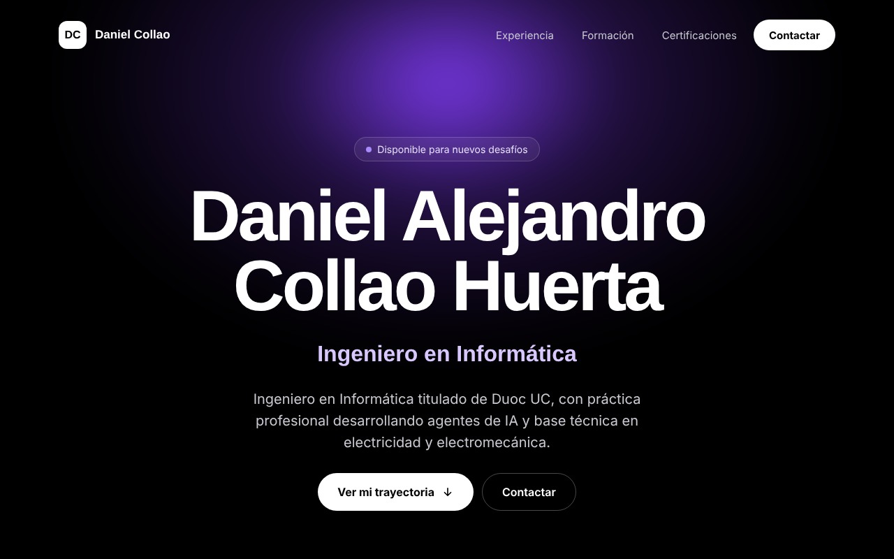

<div align="center">

# 👨‍💻 Daniel Alejandro Collao Huerta

### Ingeniero en Informática · Desarrollo de agentes de IA · Técnico en Electricidad

**CV interactivo, rápido y sin dependencias — hecho con HTML, CSS y JavaScript puro.**


[📬 Contactar](mailto:danielcollao09@gmail.com) · [💬 WhatsApp](https://wa.me/56957432276) · [🚀 Ver en local](#-cómo-verlo-en-tu-computador-paso-a-paso)

<br>



</div>

---

## ✨ ¿Qué tiene este CV?

| | Funcionalidad | Descripción |
|---|---|---|
| 🎯 | **Rol animado** | El titular rota entre mis perfiles: Ingeniero en Informática, Desarrollo de agentes de IA, Técnico en Electricidad… |
| 🗂️ | **Experiencia filtrable** | Filtra por *Tecnología*, *Electricidad* u *Otros* y toca cada tarjeta para ver el detalle. |
| 🎓 | **Formación** | Título de Ingeniero en Informática (Duoc UC, nota 5,6) y Técnico Nivel Medio en Electricidad. |
| 🏅 | **8 certificaciones Duoc UC** | Filtrables por área y verificables con el ID oficial **3561231641**. |
| 📋 | **Contacto en un clic** | Correo, botón para copiarlo, teléfono y WhatsApp. |
| 📱 | **Responsive** | Se ve bien en celular, tablet y escritorio. |

---

## 🚀 Cómo verlo en tu computador (paso a paso)

> 💡 **No necesitas instalar nada.** Es un sitio estático: basta con descargarlo y abrir `index.html` en el navegador. Elige la opción que te acomode.

### 1️⃣ Descargar el proyecto

**Opción A — Sin Git (la más fácil)**

1. Entra a 👉 [github.com/DanielCollao/Cv](https://github.com/DanielCollao/Cv)
2. Haz clic en el botón verde **`<> Code`**.
3. Elige **`Download ZIP`**.
4. Busca el archivo `Cv-main.zip` en tu carpeta de **Descargas**.
5. Haz clic derecho → **Extraer todo…** (Windows) o doble clic (macOS).

**Opción B — Con Git**

Abre una terminal (PowerShell, CMD, Terminal de macOS o Linux) y ejecuta:

```bash
git clone https://github.com/DanielCollao/Cv.git
cd Cv
```

### 2️⃣ Abrir el CV

**Opción A — Doble clic (recomendado)** 🖱️

1. Abre la carpeta `Cv` (o `Cv-main` si lo descargaste como ZIP).
2. Haz **doble clic en `index.html`**.
3. ¡Listo! Se abrirá en tu navegador predeterminado (Chrome, Edge, Firefox, Safari…).

> Si se abre con otro programa (por ejemplo, un editor de texto), haz clic derecho sobre `index.html` → **Abrir con** → elige tu navegador.

**Opción B — Desde la terminal** ⌨️

Dentro de la carpeta del proyecto:

| Sistema | Comando |
|---|---|
| 🪟 Windows | `start index.html` |
| 🍎 macOS | `open index.html` |
| 🐧 Linux | `xdg-open index.html` |

**Opción C — Con un servidor local (opcional)** 🌐

Útil si quieres verlo como un sitio web real en `http://localhost`. Usa **solo uno** de estos:

```bash
# Con Python 3 (viene instalado en macOS y la mayoría de Linux)
python -m http.server 8000      # en algunos sistemas: python3 -m http.server 8000

# Con Node.js
npx serve .
```

Luego abre en el navegador 👉 **http://localhost:8000** (o la dirección que te muestre la terminal).
Para detener el servidor, presiona **`Ctrl + C`** en la terminal.

**Opción D — Visual Studio Code + Live Server** 🧩

1. Abre la carpeta del proyecto en **VS Code** (`Archivo → Abrir carpeta…`).
2. Instala la extensión **Live Server** (de Ritwick Dey) desde la pestaña de extensiones.
3. Haz clic derecho sobre `index.html` → **Open with Live Server**.
4. El CV se abrirá y **se recargará solo** cada vez que guardes un cambio. ✨

### 🛠️ ¿Algo no se ve bien?

| Problema | Solución |
|---|---|
| Las tipografías se ven distintas | Las fuentes *Sora* y *Manrope* se cargan desde Google Fonts: revisa tu conexión a internet. Sin conexión el CV funciona igual, con fuentes del sistema. |
| Las tarjetas o filtros no responden | Verifica que `script.js` esté en la misma carpeta que `index.html` y que JavaScript esté habilitado en el navegador. |
| La página sale sin estilos | Asegúrate de que `styles.css` esté junto a `index.html` y de haber **extraído** el ZIP (no abrirlo desde dentro del comprimido). |
| `python` no se reconoce | Prueba con `python3` o `py`, o usa directamente la Opción A (doble clic). |

---

## 📁 Estructura del proyecto

```
Cv/
├── index.html    → Estructura y contenido del CV
├── styles.css    → Diseño, colores y animaciones
├── script.js     → Datos (experiencia y certificaciones), filtros e interacciones
├── assets/
│   └── preview.png → Captura usada en este README
└── README.md
```

> ✏️ **¿Quieres actualizar la información?** La experiencia laboral y las certificaciones están como listas al inicio de `script.js` (`EXP` y `CERTS`): basta con editar o agregar elementos ahí.

---

## 🌍 Publicarlo en internet (GitHub Pages)

1. En el repositorio, ve a **Settings → Pages**.
2. En *Source* elige **Deploy from a branch**.
3. Selecciona la rama **`main`** y la carpeta **`/ (root)`** → **Save**.
4. En uno o dos minutos estará disponible en `https://danielcollao.github.io/Cv/`.

---

<div align="center">

## 🤝 Conversemos

Busco un trabajo estable donde seguir creciendo profesionalmente, asumir nuevos retos y capacitarme de forma continua.

📧 **[danielcollao09@gmail.com](mailto:danielcollao09@gmail.com)** · 📱 **[+56 9 5743 2276](tel:+56957432276)** · 💬 **[WhatsApp](https://wa.me/56957432276)**

📍 Los Andes, Región de Valparaíso, Chile

<sub>© 2026 Daniel Collao</sub>

</div>
